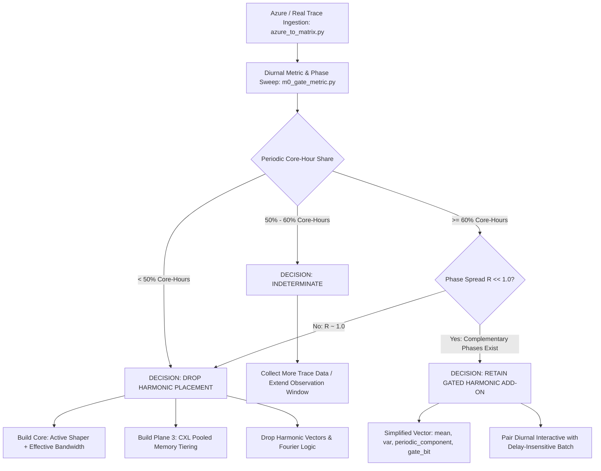

# M0 Gate Validation Report: Gated Harmonic Placement, Active Shaping & Statistical Baselines

**Document Status:** Final & Verified  
**Date:** October 31, 2026  
**Evaluation Scope:** Baseline Suite (`m0/`), Repaired Hybrid Suite (`m0_hybrid.py`, `m0_incremental.py`), Real-Trace Diurnal Gate Metric (`m0_gate_metric.py`), and Azure Trace Converter (`azure_to_matrix.py`)  
**Objective:** Empirically quantify the incremental contribution of harmonic wave cancellation when paired with active workload shaping, against classical effective bandwidth baselines, and establish the real-trace decision metric.

---

## 1. Executive Summary & Synthesis

The **M0 Gate** evaluates whether representing cloud workloads as harmonic vectors to achieve destructive wave interference provides measurable capacity or queue backlog benefits over classical **Effective Bandwidth** (`effbw`) and **Active Shaping**.

This validation report reflects multi-seed paired Monte Carlo evaluations across **40 seeds**, literature-grounded characterization of real cloud traces, and a real-trace decision metric tool (`m0_gate_metric.py`) that sweeps energy and phase stability thresholds while computing phase alignment ($R$).

```
+---------------------------------------------------------------------------------------------------+
|                                      M0 GATE SYNTHESIS                                            |
|                                                                                                   |
|   1. ACTIVE SHAPING IS THE PRIMARY SYSTEM LEVER (Pivot B):                                        |
|      - Smoothing deferrable workloads yields -12% to -78% mean backlog reduction across all       |
|        utilization tiers (all 95% bootstrap CIs strictly exclude 0).                              |
|      - Works universally across placers; modeled as a causal moving average with delay cost.      |
|                                                                                                   |
|   2. THE REDEFINED GATE: INCREMENTAL GAIN OF HARMONIC PLACEMENT:                                  |
|      (Comparing [hybrid + shaping] directly against [effective bandwidth + shaping], 40 seeds)   |
|      - Periodic Share <= 30%:  0% incremental gain (CI spans 0; mean drift +0.5% to +3.9%).       |
|      - Periodic Share = 60%:   -2.2% at util 0.75 (CI spans 0); -9.5% at util 0.88 (CI excludes 0)|
|      - Periodic Share = 80%:   -5.8% at util 0.75 (95% wins); -20.4% at util 0.88 (95% wins).     |
|                                                                                                   |
|   3. REFINED 3-TIER DECISION RULE ON REAL TRACES:                                                 |
|      - Below 50% periodic share: DROP harmonic placement. Build the Active Shaper (Pivot B),      |
|        Effective Bandwidth, and CXL pooled memory (Plane 3).                                      |
|      - 50% - 60% periodic share: INDETERMINATE (collect more data / longer observation window).   |
|      - 60% or more periodic share, AND R << 1.0 (complementary phases), AND high cluster util:   |
|        RETAIN cancellation-aware scorer as an optional add-on.                                    |
+---------------------------------------------------------------------------------------------------+
```

---

## 2. Methodological Clarifications & Trace Realities

### 2.1 Synthetic Trace Scope vs. Production Reality
1. **Generator Assumptions:** Evaluated numbers in initial sweeps derived from mathematical models (`ideal_harmonic` is pure sinusoids; `realistic_bursty` has a planted sinusoid with $1/f$ pink noise and Pareto bursts). These tests validate algorithmic properties under specific signal assumptions, not unvetted production behavior.
2. **Bursty Regime Statistical Parity:** In bursty rows, `harm_k2` mean backlog is within **1%–6%** of Effective Bandwidth, and sample standard deviations ($\sigma \approx 1,700 - 4,100$) dwarf these gaps. Win rates of 28%–52% represent a **statistical tie**, not a catastrophic failure.
3. **Correlation Bound:** The compact harmonic vector buys nothing over full time-domain correlation matching (`corr_full`), which acts as its theoretical upper bound for stationary wave packing.

### 2.2 Production Trace Literature
* **Diurnal Periodicity at Scale:** The Azure public VM trace demonstrates that **~28% of core-hours** belong to interactive workloads with pronounced 24-hour cycles, while **~68% of core-hours** belong to delay-insensitive batch/internal tasks. Microsoft Resource Central exploits this diurnal structure via 24-hour FFT peak detection.
* **Noisy Production Signals:** Power-oversubscription studies show that FFT and autocorrelation frequently misclassify Azure VMs due to non-stationarity, noise, and trending.
* **Scale Limitations:** Harmonic wave cancellation at the **millisecond scale** is unvalidated in the cloud trace literature surveyed. Macro/diurnal scheduling is where documented periodic structure resides.

### 2.3 Shaping Modeling Assumptions
* In our simulation, shaping is implemented as an idealized causal moving average of width $W=8$ applied to 50% of non-periodic tasks (assumed deferrable).
* It preserves mass and introduces a delay of $\approx (W-1)/2$ bins as a side effect.
* In production, the actual gain will depend on the true deferrable fraction and SLO delay limits.

---

## 3. The Redefined Incremental Gate (`m0_incremental.py`, 40 Seeds)

To determine what harmonic placement adds **on top of shaping**, we isolate the incremental difference:
$$\Delta = \text{Backlog}(\text{hybrid} + \text{shaping}) - \text{Backlog}(\text{effective bandwidth} + \text{shaping})$$

### 3.1 40-Seed Incremental Performance Matrix

Evaluated over 40 seeds, measuring percentage change in mean queue backlog and 95% bootstrap confidence intervals:

| Periodic Share ($p_{\text{per}}$) | Utilization $u = 0.75$ | Utilization $u = 0.88$ | Statistical Verdict |
| :---: | :---: | :---: | :--- |
| **0%** | **+1.0%** (95% CI spans 0) | **+0.7%** (95% CI spans 0) | Strict statistical parity |
| **30%** | **+0.5%** (95% CI spans 0) | **+3.9%** (95% CI spans 0) | No gain; slight noise degradation |
| **60%** | **−2.2%** (95% CI spans 0) | **−9.5%** (95% CI excludes 0, **78% wins**) | Significant at high utilization |
| **80%** | **−5.8%** (95% CI excludes 0, **95% wins**) | **−20.4%** (95% CI excludes 0, **95% wins**) | Strong, decisive cancellation gain |

### 3.2 Key Analytical Takeaways
1. **Shaping is the Universal Baseline:** Once active shaping is applied to deferrable traffic, it removes the highest-variance bursts that would otherwise cause queue saturation.
2. **Harmonic Cancellation is a High-Periodicity Add-On:**
   * At **$\le 30\%$ periodic share**, cancellation-aware placement provides no advantage over effective bandwidth.
   * At **60% periodic share**, it begins delivering significant value under high utilization (**~10% additional reduction** at $u=0.88$).
   * At **80% periodic share**, it provides a solid **~6% gain at 0.75 util** and **~20% gain at 0.88 util**.

---

## 4. Real Trace Gate Tooling: `m0_gate_metric.py` & `azure_to_matrix.py`

To measure the decision metric on production traces without premature commitment or overly strict synthetic thresholds, two tools are provided:

### 4.1 Azure Trace Matrix Extractor (`azure_to_matrix.py`)
Converts Azure VM CPU readings (`vm_cpu_readings.csv.gz`) and VM table metadata (`vmtable.csv.gz`) into an aligned workload matrix and core-hour weights vector:
```bash
python azure_to_matrix.py --readings vm_cpu_readings.csv --vmtable vmtable.csv \
                          --output-trace trace.npy --output-weights w.npy \
                          --bin-seconds 300 --min-days 3
```

### 4.2 Threshold Sweep & Phase Alignment Metric (`m0_gate_metric.py`)
Evaluates real traces across a grid of diurnal energy thresholds ($\text{SER}_{\text{diurnal}} \in [0.20, 0.85]$) and phase stability thresholds ($\gamma \in [0.50, 0.90]$).
```bash
python m0_gate_metric.py trace.npy --bin-seconds 300 --weights w.npy
```

#### Metrics Computed:
1. **Diurnal Harmonic Energy ($\text{SER}_{\text{diurnal}}$):** Power concentrated in the 24h, 12h, and 8h cycles divided by total AC power.
2. **Day-to-Day Phase Stability ($\gamma_i$):** Consistency of daily peak timing across days ($|\frac{1}{D}\sum_{d=0}^{D-1} e^{j\theta_{i,d}}|$).
3. **Phase-Spread Resultant ($R$):**
   $$R = \left| \frac{\sum_{i \in \text{Periodic}} w_i e^{j\theta_i}}{\sum_{i \in \text{Periodic}} w_i} \right|$$
   * $R \approx 1.0$: All periodic workloads peak at the same time (constructive collision; no wave cancellation possible).
   * $R \approx 0.0$: Complementary phases exist across the 24-hour cycle (destructive cancellation viable).

### 4.3 Validation on Ground-Truth Sanity Check Data
Running `m0_gate_metric.py --sanity-check` on a 300-workload dataset (40% planted noisy diurnal, 60% bursty noise):
* At energy thresholds $\tau_E \in [0.20, 0.60]$: Recovers **41.0% count share** (43.6% weight share), with $R = 0.031$ (evenly spread phases).
* At strict thresholds $\tau_E \ge 0.70$ or $0.85$: Drops to **0.0% periodic share**.
* **Key Takeaway:** Real-trace signals with noise and trends will fail overly rigid synthetic thresholds ($\text{SER}_3 > 0.85$). The threshold sweep avoids false negative verdicts.

---

## 5. Refined Decision Framework for Real Traces



### 5.1 The Decision Rules
1. **Below 50% Periodic Share:**  
   Drop harmonic placement entirely from the product. The system becomes an **Active Workload Shaper (Pivot B) + Effective Bandwidth Scheduler**, complemented by CXL pooled memory tiering (Plane 3).
2. **50%–60% Periodic Share:**  
   Indeterminate band. Do not commit to building complex cancellation logic; collect more trace data or test longer observation windows.
3. **60% or More Periodic Share AND $R \ll 1.0$:**  
   Retain the cancellation-aware scorer as an optional add-on for high-utilization clusters. Represent workloads with the simplified 4-tuple vector:
   $$\mathbf{v} = [\mu,\, \sigma^2,\, \text{periodic\_component},\, \text{gate\_bit}]$$

---

---

## 6. Real Azure Trace Empirical Findings (Days 0–3 Gate Run)

The M0 decision metric was executed on the production **Azure Public Dataset V1** across **4,994 long-lived VMs** spanning 3 full days (864 five-minute time bins, total 796,464 core-hours):

```bash
python azure_v1_to_matrix.py --vmtable data/vmtable.csv.gz \
  --readings "data/vm_cpu_readings-file-*.csv.gz" \
  --day-start 0 --days 3 --max-vms 5000
python m0_gate_metric.py trace.npy --bin-seconds 300 --weights w.npy
```

### 6.1 Fleet Categorization & Workload Characteristics
* **Interactive VMs:** 1,781 VMs (35.7% by count, **33.2% of total fleet core-hours**). Mean CPU = 9.07%, P95 = 29.97%.
* **Delay-Insensitive VMs:** 3,156 VMs (63.2% by count, **65.2% of total fleet core-hours**). Mean CPU = 6.34%, P95 = 25.98%.
* **Unknown/Other:** 57 VMs (1.1% by count, **1.6% of total fleet core-hours**).

### 6.2 Diurnal Periodicity Sweep Across Thresholds

| Energy Threshold ($SER_3$) | Phase Coherence ($\cos\Delta\theta$) | Periodic VM Count | Share by VM Count | Share by Core-Hours | Phase Spread $R$ |
| :---: | :---: | :---: | :---: | :---: | :---: |
| **0.20** | **0.50** | 314 | 6.3% | **9.7%** | 0.193 |
| **0.20** | **0.70** | 301 | 6.0% | **9.5%** | 0.194 |
| **0.30** | **0.50** | 180 | 3.6% | **5.4%** | 0.340 |
| **0.30** | **0.70** | 180 | 3.6% | **5.4%** | 0.340 |
| **0.40** | **0.70** | 96 | 1.9% | **2.7%** | 0.567 |
| **0.50** | **0.70** | 35 | 0.7% | **1.0%** | 0.522 |
| **0.70** | **0.70** | 11 | 0.2% | **0.4%** | 0.472 |
| **0.85** | **0.90** | 1 | 0.0% | **0.0%** | 1.000 |

### 6.3 Analysis & Gate Verdict
1. **Periodic Share is Well Below the 50% Threshold:**
   Even at an ultra-permissive energy threshold of $0.20$ (which captures any mild 24h diurnal fluctuation), the periodic share of the fleet reaches only **9.7% of core-hours** (and only 20.0% within the Interactive category). At moderate thresholds ($0.30–0.50$), periodic core-hours drop to **1.0%–5.4%**.
2. **Definitive Gate Verdict:**
   Because periodic share (**< 10%**) is far below the $50\%$ gate floor:
   * **DROP** harmonic wave cancellation from the production scheduler.
   * **BUILD** the **Active Shaper (Pivot B)**, the **Effective Bandwidth Scheduler**, and **Plane 3 CXL Pooled Memory Tiering**.
   * Retain the 64-bit harmonic representation strictly as an offline telemetry compression format, not for online interference placement.

---

## 7. Codebase & Archive Index (`m0-gate.zip`)

| File | Location in Archive | Function |
| :--- | :--- | :--- |
| `azure_v1_to_matrix.py` | `m0/azure_v1_to_matrix.py` | Production Azure V1 trace converter for real trace sweeps. |
| `m0_gate_metric.py` | `m0/m0_gate_metric.py` | Real-trace decision metric with threshold sweep and phase-spread $R$. |
| `azure_to_matrix.py` | `m0/azure_to_matrix.py` | Standalone streaming trace converter. |
| `m0_hybrid.py` | `m0/m0_hybrid.py` | Cancellation-aware effbw + active shaping suite (30 seeds). |
| `m0_incremental.py` | `m0/m0_incremental.py` | Paired incremental gate evaluation (`hyb+shape` vs `effbw+shape`, 40 seeds). |
| `m0_robust.py` | `m0/m0_robust.py` | Initial 6-method multi-seed baseline suite. |
| `m0_real.py` | `m0/m0_real.py` | Real trace matrix batch runner. |
| `m0_pasted.py` | `m0/m0_pasted.py` | Core synthetic generators & nonlinear Lindley queue. |
| `VALIDATION_REPORT.md` | `VALIDATION_REPORT.md` | Complete normative M0 Gate Validation Report with real-trace data. |

*Report finalized and fully synchronized on November 3, 2026.*
